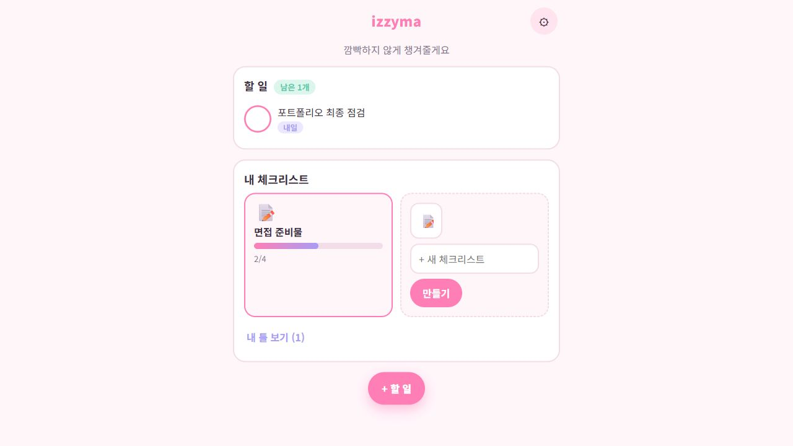
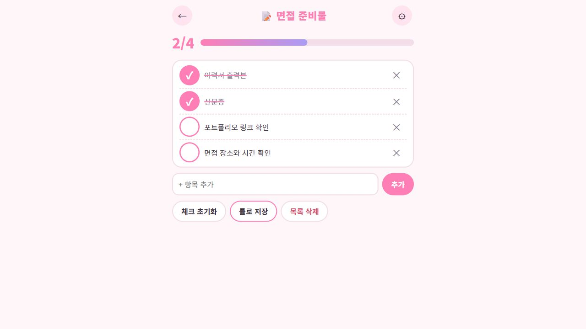
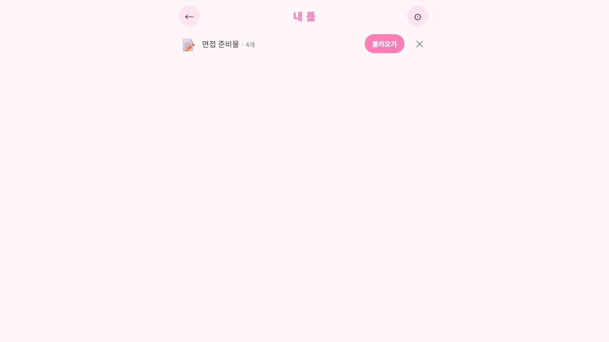

<div align="center">

# izzyma

**깜빡하지 않게, 나가기 전에 한 번 더.**<br>
준비물과 할 일을 챙기고, 자주 쓰는 목록을 다시 꺼내 쓰는 개인 체크리스트

`HTML · CSS · JavaScript` · `Local Storage` · `오프라인 지원`

[화면과 기능](#화면으로-보는-사용-흐름) · [설계 의도](#설계에서-고민한-점) · [실행 방법](#실행-방법) · [기획서](기획서.md)

</div>



> GitHub에 커밋된 앱을 실제 브라우저에서 실행한 화면입니다. 면접 준비물과 할 일은 설명용으로 입력했습니다.

## 왜 만들었나요?

외출할 때 준비물을 빠뜨리거나 해야 할 일을 잊고, 여행이나 면접이 있을 때마다 비슷한 목록을 다시 쓰는 불편에서 시작했습니다.

목표는 **목록을 열면 빠진 것이 보이고, 다음에도 같은 목록을 쉽게 다시 쓰는 것**입니다. 개인용이라는 범위에 맞춰 팀 공유나 복잡한 프로젝트 관리 기능은 넣지 않았습니다.

| 사용 장면 | 필요한 기능 | 결과 |
|---|---|---|
| 외출·여행·면접 준비 | 준비물 목록과 진행률 | 아직 챙기지 않은 항목 확인 |
| 기한이 있는 일 | 마감일과 알림 시간 | 가까운 일부터 처리 |
| 같은 준비를 다시 할 때 | 틀 저장과 불러오기 | 빈 체크 상태의 새 목록 생성 |

## 화면으로 보는 사용 흐름

### 01. 오늘 할 일과 준비물을 함께 보기

홈에서는 할 일과 내 체크리스트를 구분해 보여 줍니다. 할 일은 마감이 가까운 항목을 먼저, 끝낸 항목을 나중에 배치합니다. 체크리스트 카드는 `2/4` 같은 진행률로 남은 준비를 알려 줍니다.

### 02. 하나씩 챙기고, 다음 사용을 위해 저장하기



준비물을 직접 추가하고 체크하면 진행률이 바뀝니다. 같은 목록을 다시 쓰려면 **체크 초기화**, 자주 반복할 준비라면 **틀로 저장**을 사용합니다. 초기화와 삭제에는 재확인 단계가 있습니다.

<details>
<summary><strong>저장한 틀을 다시 꺼내 쓰는 화면 보기</strong></summary>



틀을 불러오면 기존 목록을 바꾸지 않고, 체크가 비어 있는 새 목록을 만듭니다.

</details>

## 주요 기능

| 기능 | 내용 |
|---|---|
| 체크리스트 | 목록 만들기, 항목 추가·삭제, 체크, 진행률과 완료 안내 |
| 반복 사용 | 체크 초기화, 틀 저장·불러오기 |
| 할 일 | 제목·마감일·알림 시간, 추가·수정·완료 |
| 준비물 연결 | 할 일 입력에서 준비물로 구분하면 체크리스트 항목으로 추가 |
| 알림 | 오늘 마감이고 알림 시간이 지난 항목을 안내, 같은 시각 중복 알림 방지 |
| 데이터 옮기기 | 설정에서 내보내기·가져오기 |
| 화면 | 라이트·다크 테마, 작은 화면 대응, 체크 애니메이션 |
| 오프라인 | 최초 접속 후 서비스 워커로 앱 파일 보관, 홈 화면 추가 지원 |

## 설계에서 고민한 점

- **할 일과 준비물은 구분합니다.** “예약 전화하기”와 “신분증 챙기기”는 완료 방식이 다르므로 화면에서 목적을 나눴습니다.
- **재사용할 때는 체크를 비웁니다.** 지난번 완료 상태를 그대로 가져와 아직 챙기지 않은 물건을 놓치지 않도록 했습니다.
- **계정 없이 시작합니다.** 서버 없이 브라우저에 저장하는 작은 구조로 핵심 사용 흐름부터 구현했습니다. 대신 자동 동기화의 부재를 명확히 안내합니다.
- **화면과 데이터 규칙을 분리합니다.** `app.js`는 화면 이동과 입력, `storage.js`는 저장·정렬·알림 대상·진행률 계산을 담당합니다.

## 실행 방법

저장소 폴더에서 실행합니다.

```bash
python -m http.server 5175
```

[http://localhost:5175](http://localhost:5175)를 엽니다. 별도 패키지 설치나 API 키는 필요 없습니다. 홈 화면 추가와 오프라인 기능은 `localhost` 또는 HTTPS 환경에서 사용합니다.

## 검증과 구현 자료

[http://localhost:5175/tests.html](http://localhost:5175/tests.html)에서 저장·진행률·초기화·틀·정렬·알림 대상·내보내기 규칙을 검사할 수 있습니다.

| 파일 | 역할 |
|---|---|
| [index.html](index.html), [style.css](style.css) | 화면 뼈대와 파스텔 디자인 |
| [app.js](app.js) | 홈·상세·할 일·틀·설정의 화면 동작 |
| [storage.js](storage.js), [tests.html](tests.html) | 데이터 규칙과 테스트 |
| [sw.js](sw.js), [manifest.webmanifest](manifest.webmanifest) | 오프라인 캐시와 홈 화면 앱 설정 |
| [기획서](기획서.md), [화면 설계](화면설계.md) | 초기 목적과 설계 과정 |

## 현재 범위와 다음 과제

**구글 로그인과 기기 간 자동 동기화는 초기 기획에 있지만 현재 구현에는 없습니다.** 데이터는 사용하는 브라우저 한 곳에 저장되며, 다른 기기로 옮길 때는 내보내기·가져오기를 사용합니다.

알림은 페이지가 열려 있을 때 동작합니다. 앱을 닫아도 도착하는 서버 푸시 알림은 제공하지 않습니다. 실제 휴대폰의 홈 화면 설치와 알림 동작은 추가 확인이 필요합니다.

이후 [아 마따!](https://github.com/huijae1234/amatta)에서는 관심을 **“빠뜨리지 않기”에서 “이미 확인한 것을 왜 다시 확인하는지 기록하기”**로 확장했습니다. 생성형 AI와 함께 만든 개인 학습 프로젝트입니다.
